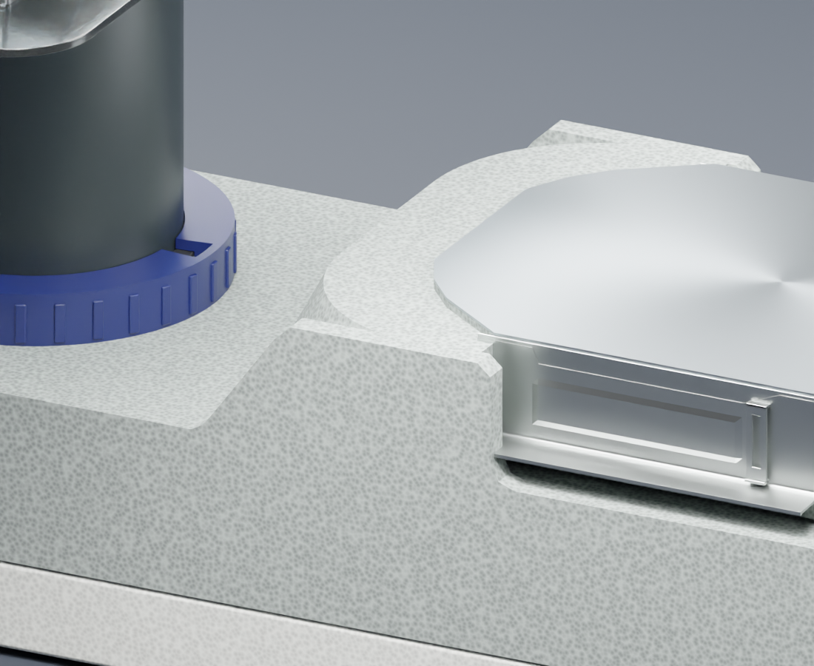

# CleanLine 3D

Blender 产品模型与 Three.js 交互展示。当前版本包含已连通的弧形支撑：两侧肩部与中央实体连续连接。



## 获取项目

点击 GitHub 的 **Code → Download ZIP** 下载，或克隆此仓库。解压后保留目录结构。

- **Blender 工程**：[CleanLine_154150001.blend](blender/output/CleanLine_154150001.blend)，使用 Blender 4.2 LTS 或更新版本打开。
- **通用三维模型**：[cleanline.glb](web/public/models/cleanline.glb)，可导入支持 glTF 的工具。
- **Web 源码**：`web/`，支持旋转、缩放、爆炸视图、组件显隐和正交视图。
- **参考图**：`reference/`；最终局部俯视、轴测图及检查记录位于 `blender/evidence/`。

## 运行网页

需要 Node.js 22 LTS 或更新版本。

```sh
cd web
npm ci
npm run dev
```

打开终端显示的本地地址，默认端口为 `5174`。不要直接双击 `index.html`，模型需要通过 HTTP 加载。

构建可部署文件：

```sh
npm run build
npm run preview -- --port 4174
```

构建产物位于 `web/dist/`，不提交到仓库。此仓库分享源文件，不自动发布在线网站。

## 从 Blender 更新 Web 模型

1. 打开并保存 `blender/output/CleanLine_154150001.blend`。
2. 在 Blender 的 Scripting 工作区打开 `blender/scripts/export_web.py`，点击 Run Script。
3. 导出会更新 `web/public/models/` 中的 GLB、纹理和组件列表。脚本由已保存的工程位置推导路径，无需修改本机路径。
4. 刷新网页；发布构建前重新运行 `npm run build`。

最终 `.blend` 是当前模型的源文件。一次性建模、回滚脚本及过期备份已移入本地归档，不包含在此仓库中。

## 浏览器检查

先在一个终端启动 `npm run preview -- --port 4174`，另一个终端运行：

```sh
cd web
npx playwright install chromium
node tests/browser-check.mjs
```

可通过 `BASE_URL` 指定其他预览地址，通过 `CHROME_PATH` 指定已安装的 Chrome 可执行文件。快速检查工程视图可追加 `--workbench`。截图及检查结果输出至 `web/evidence/`。

## 参考与范围

本项目是 Geberit CleanLine 154.150.00.1 的独立三维展示研究，不是官方制造 CAD。工程图未标注的尺寸和隐藏结构存在推定。

参考照片、图纸和品牌标识归原权利人所有。产品来源：[Geberit 产品目录](https://catalog.geberit-global.com/en-XB/product/PRO_170941)。公开仓库不表示授予第三方参考资料的使用许可。
